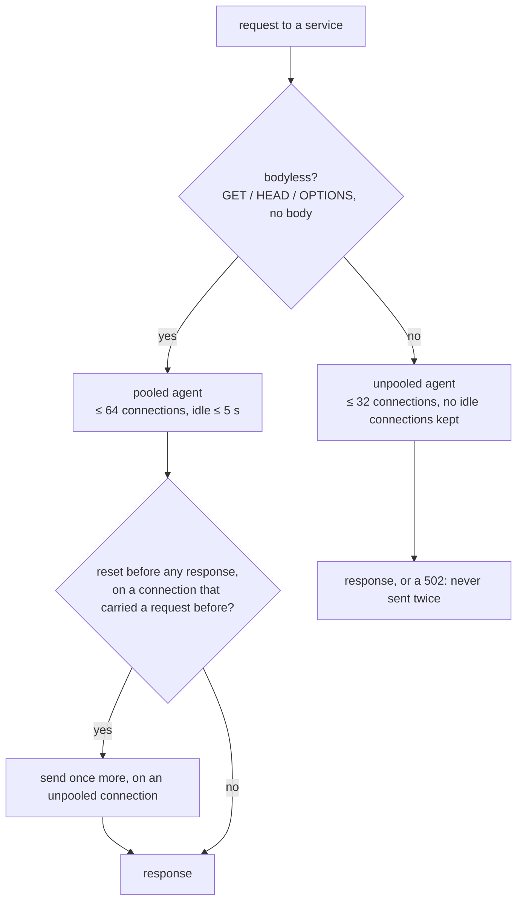

# The dev reverse proxy

How the proxy carries requests to services, and why. This is a **contributor** document; the
user-facing reference is [`../dev-reverse-proxy.md`](../dev-reverse-proxy.md).

**It is a development tool, not a production proxy.** It listens on loopback, trusts every client,
does no auth, serves self-signed certificates, and sends each service to one local port with no
load balancing, health checks or caching. Its limits and timeouts are set for a developer's
browser, not for hostile or high-volume traffic.

Code: `packages/stackctl/src/dev-reverse-proxy.ts` (servers, routing, status pages) and
`packages/stackctl/src/upstream-pool.ts` (connections to services). Specs sit beside each.

## What it does

- **One port per project, three protocols on it.** HTTP/1.1, h2c, and, with `tls`, TLS
  (HTTP/2 or HTTP/1.1 by ALPN).
- **Routing.** `reverseProxy.routes` is tried in order: the entry whose subdomain is the host's
  (else the `'*'` one) takes the request, to its service or to the first of its globs (compiled
  once, with picomatch) the path matches. A miss is a 404, never another entry.
- **Answers for services that aren't up.** stackctl knows each service's live status, so a
  stopped or starting one gets a status page instead of a connection error.
- **Websockets** (Vite's HMR) are forwarded on a connection of their own, outside the pool.
- **Idle client connections are kept for 10 minutes.** That's longer than a TLS terminator in
  front (Caddy: 2 minutes) keeps them, so the terminator always closes them first and never sends
  on one the proxy is closing.

## Connections to services

A page load from a dev server like Vite sends hundreds of module requests at once, nearly all of
them `GET`s. Two things go wrong with naive forwarding:

1. **Too many connects.** macOS queues at most 128 connections a listener hasn't accepted yet
   (`kern.ipc.somaxconn`). Past that it refuses or resets them, and each one becomes a 502.
2. **The keep-alive race.** A service closes an idle connection without warning. A request sent
   on it at that moment is reset before the service reads it. That's harmless to resend, but a
   proxy that doesn't resend it returns a 502.

- **Bodyless requests share a pool.** It holds at most 64 connections per service, and a burst
  past that waits in a queue rather than dialing. An idle connection is kept 5 s, or for the
  service's announced `Keep-Alive: timeout` minus 2 s when that's sooner. A connection the
  service closes leaves the pool at once.
- **One retry, hidden from the proxy.** A pooled request reset (`ECONNRESET`, or `EPIPE` while
  writing) before any response, on a connection that carried a request before, never reached the
  service. It is sent once more on a new connection, never another pooled one: a service that
  restarts closes all its idle connections at once.
- **Reuse is tracked per socket, not by Node's `reusedSocket`.** When requests are queued, Node
  hands a freed connection straight to the next one and leaves that flag `false`. A `WeakSet` of
  every socket that has carried a request catches those too.
- **Requests with a body go through a separate agent.** It keeps no idle connections, and a
  request on it is never sent twice, because its body may already have been streamed. It allows
  32 connections per service: uncapped, a burst of POSTs opened one connection each and hit the
  128 limit.
- **96 connects at most per service** (64 + 32), leaving room under 128 for the service's other
  clients.
- **Error answers.** A connection refused, or a new connection reset before any response, means
  nothing is listening. For a service the session doesn't run that's a 503; anything else is a
  502.

## Why this shape

The proxy used to learn each service's idle timeout from the closes it observed. That was dropped
for the conventional answer to the keep-alive race (undici's retry of idempotent requests, nginx's
`proxy_next_upstream`): resend what the service never read. The retry covers every server,
including one that closes connections sooner than any timeout we'd pick. It fixes the first
failure too, not just later ones, and its specs don't depend on timing.

Measured on macOS with a Go service and Vite behind Caddy (h2c):

- **The idle-close race** (36,000 requests at idle closes of 50 ms–2 s): 0 failures.
- **GET bursts** of 1680 × 3: all 200.
- **Bursts of 2000 POSTs**: 0 failures, at about 1.2× the old learning proxy's time.
- **A mixed page load**: 0 failures, 5% slower than the old proxy.

## Limitations

- **A request with a body on a connection that was just handed over can still be a 502** if the
  service resets it. That takes a service that closes idle connections within milliseconds; no
  common server does (Node and uvicorn take 5 s, gunicorn 2 s).
- **The retry is tried once.** If it is also reset, the browser gets a 502.
- **The caps are per service, not global**, and they're tuned to macOS's 128. Linux's default
  limit is higher (4096), where they're merely conservative.
- **HTTP/1.1 only to services.** HTTP/2 stops at the proxy.
- **Load-sensitive.** At 1000+ concurrent requests on a heavily loaded machine, failures come from
  the OS (refused connects, ephemeral-port exhaustion), not the proxy's logic.
